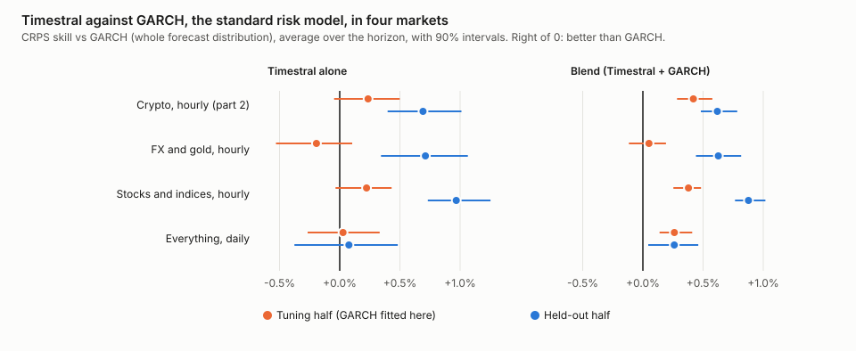
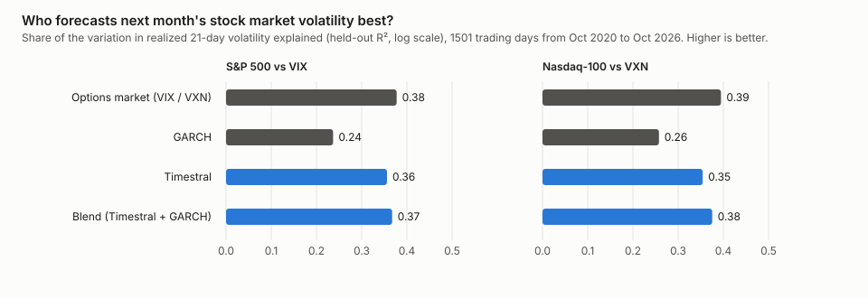

# Part 4: Beyond crypto: stocks, currencies, gold, and a match against the VIX

coinband project · November 2026 · unofficial, not affiliated with Mistral AI, Yahoo or Cboe · not financial advice

> **The short version**
>
> - Parts [1](paper.md) to [3](options.md) tested Timestral on crypto only. Here we asked whether any of it carries
>   over to **stocks, stock indices, currencies and gold**: 16 markets, hourly and daily, using the crypto settings
>   unchanged.
> - **It does.** Timestral's ranges beat the simple statistical guess by about 1.3% to 1.9% on data it was never tuned
>   on, about the same edge as on crypto. Its 80% ranges held the price about 80% of the time.
> - **It still cannot call the direction**: up or down right 51% to 53% of the time, a coin flip.
> - **Against GARCH**, the standard risk model, the pattern from crypto repeated: on hourly data Timestral tied GARCH
>   in one half and beat it in the other; on daily data it tied. **Averaging Timestral with GARCH beat GARCH** in
>   seven of the eight market-and-period tests.
> - **Against the VIX**, Wall Street's "fear index": a model that reads only past prices forecast next month's
>   S&P 500 and Nasdaq-100 volatility **about as well as the options market**, and much better than GARCH. It also
>   carried information the VIX did not.
> - One currency looked spectacular and is not: the Turkish lira (see [the box below](#the-turkish-lira-trap)).

## What we did, in plain words

Everything in this part uses the same yardsticks as before:

- **Accuracy**: for each forecast, compare Timestral's whole range with what happened, and compare it with a simple
  statistical guess (the "random walk": the price wanders with the same jumpiness as recently). Positive skill means
  Timestral's ranges were better.
- **Risk**: pit Timestral against the four standard risk models from [part 2](risk.md), including GARCH, and check its
  "worst likely loss" lines (Value-at-Risk).
- **Options**: compare its volatility forecast with the options market's own forecast, as in [part 3](options.md),
  this time with the VIX.

The markets, all from Yahoo Finance:

- **Stocks and indices**: S&P 500, Nasdaq-100, Apple, Microsoft, Nvidia, Amazon, and from Istanbul the BIST 100 index,
  Turkish Airlines (THYAO) and Garanti BBVA (GARAN).
- **Currencies**: EUR/USD, USD/JPY, GBP/USD, AUD/USD, USD/CHF and USD/TRY.
- **Gold** futures.

Two things are different from crypto:

- **Markets close.** Stocks trade about seven hours a day, five days a week, so an hourly stock chart jumps overnight
  and over weekends. The model sees those jumps as ordinary bars. Currencies and gold trade almost around the clock
  on weekdays.
- **Less hourly history.** Yahoo keeps only two years of hourly bars. That is plenty for currencies (about 12,000
  hours) but only about 3,500 bars for US stocks. So hourly stocks get a shorter context (1,024 bars instead of
  4,096) and a horizon of 7 bars, about one trading day. Daily bars go back decades, so daily tests cover about twelve
  years.

**Nothing was tuned on these markets.** Timestral's settings are the crypto defaults from part 1, or the nearest that
fit the data. As before, time is split in two: the baselines are fitted on the first half and everything is judged on
both, with the second half as the held-out test.

<details>
<summary>For experts: setup</summary>

- Model: Timestral-209M, unmodified, 21 quantiles (P01 to P99). Contexts: 4096 bars (FX and gold hourly), 1024 bars
  (stocks hourly), 2048 days (daily). A context variant per group (2048, 512, 512) was run as a robustness check.
- Accuracy study (`experiments/phase4/markets.py`): walk-forward origins, two consecutive periods of equal length at
  the end of the data, the earlier one called "tuning" for symmetry with part 1 although nothing was tuned on it.
  FX and gold hourly: 300 origins 8 hours apart per period, 96 hours ahead. Stocks hourly: 250 origins 4 bars apart,
  35 bars ahead. Daily: 300 origins 5 days apart, 20 days ahead. CRPS skill pooled over symbols, normalized by the
  last price, 90% moving-block bootstrap intervals (blocks of horizon/stride origins).
- Risk study (`experiments/phase4/markets_risk.py`): a forecast at every bar, USD/TRY left out. FX and gold hourly
  (8,145 to 8,293 origins per pair, 24 hours ahead): halves July 2025 to March 2026 and March to November 2026. Stocks
  hourly (2,461 origins per US symbol, 3,353 per BIST symbol, 7 bars ahead): halves May 2025 to February 2026 and
  February to November 2026. Daily (3,022 origins per symbol, the last twelve years, 21 trading days ahead): halves
  October 2014 to December 2020 and October 2020 to October 2026. Baselines and their fitting are the code of part 2
  (random walk on 500 bars, historical simulation on 2,000, EWMA and GARCH(1,1) fitted on the first half with filtered
  historical simulation); the blend averages Timestral's and GARCH's quantiles.
- Data hygiene: Yahoo's daily FX history has nine one-day spikes that reverse the next day (for example EUR/USD
  +16% and back on 8 December 2008), all in 2008 to 2009. Daily EUR/USD, USD/JPY and USD/CHF were cleaned of them
  (a move above 8 robust standard deviations undone by at least 75% the next day). Stocks were not cleaned: they
  have real reversals of that size (the S&P 500 in March 2020). The results changed by less than 0.05 points.
- Yahoo's terms restrict redistribution, so no prices are published here: the scripts fetch them on your machine.

</details>

## Finding 1: the edge carries over to stocks and currencies

On the held-out period, Timestral's ranges beat the random walk in every group:

| Market | Look-ahead | Skill vs random walk, held-out | Tuning period | Price inside the 80% range | Direction right |
|---|---|---|---|---|---|
| Crypto, hourly (part 1) | 24 hours | +2.13% | +1.90% | 79.3% | |
| Currencies and gold, hourly | 24 hours | **+1.34%** (+0.87, +1.91) | +2.92% | 82.3% | 52.9% |
| Stocks and indices, hourly | 7 bars (≈ 1 day) | **+1.90%** (+1.50, +2.46) | +0.92% | 78.8% | 51.2% |
| Everything, daily | 5 days | **+1.75%** (+1.38, +2.10) | +2.01% | 78.7% | 52.5% |

Currencies and the daily group are shown without USD/TRY (see the box below). The intervals are 90% confidence
intervals.

- **The size of the edge is the same as on crypto**: one to two percent better ranges than the simple guess, in both
  periods, in every market type.
- **The ranges are honest.** The price landed inside the 80% range 79% to 82% of the time.
- **Still no sense of direction.** Up or down was right 51% to 53% of the time, and the "most likely" price was no
  better than "the price stays where it is" (median error skill between −0.25% and +0.10%).
- **Some markets stand out.** The S&P 500 on daily bars had +7.8% skill on the held-out period (interval +5.5% to
  +10.3%), USD/JPY on hourly bars +6.1%. A few were around zero: Nvidia and the Nasdaq-100 on hourly bars, gold on
  hourly bars in the held-out period.
- **Longer history helped a little**, as with crypto: at the main horizon, the shorter-context variants were slightly
  worse in every group.

<details>
<summary>For experts: accuracy tables</summary>

CRPS skill vs the random walk, %, with 90% block-bootstrap intervals. "val" is the earlier period, "test" the later.

| Run | h=1 | mid | end | MAE skill (mid) | 80% coverage (mid) | Calibration error | Direction (mid) |
|---|---|---|---|---|---|---|---|
| FX+gold 1h, ctx 4096, val, without USD/TRY | +5.23 (+3.95, +6.90) | h=24: +2.92 (+1.97, +3.99) | h=96: +2.14 (+0.80, +3.63) | +0.06 | 80.2 | 0.22 | 52.2 |
| FX+gold 1h, ctx 4096, test, without USD/TRY | +1.54 (+0.95, +2.33) | h=24: +1.34 (+0.87, +1.91) | h=96: +1.06 (+0.33, +1.92) | +0.08 | 82.3 | 0.90 | 52.9 |
| FX+gold 1h, ctx 4096, test, with USD/TRY | +3.70 (+3.01, +4.67) | h=24: +4.40 (+3.88, +5.16) | h=96: +5.01 (+4.30, +6.04) | +1.79 | 83.9 | 1.96 | 58.6 |
| Stocks 1h, ctx 1024, val | +3.06 (+2.40, +3.93) | h=7: +0.92 (+0.54, +1.45) | h=35: +0.16 (−0.38, +0.90) | −0.33 | 76.5 | 1.07 | 49.9 |
| Stocks 1h, ctx 1024, test | +4.76 (+3.96, +5.61) | h=7: +1.90 (+1.50, +2.46) | h=35: +1.30 (+0.81, +1.92) | −0.25 | 78.8 | 0.67 | 51.2 |
| Daily, ctx 2048, val, without USD/TRY | +2.65 (+2.03, +3.43) | h=5: +2.01 (+1.64, +2.35) | h=20: +1.95 (+1.45, +2.45) | +0.53 | 79.3 | 2.08 | 54.1 |
| Daily, ctx 2048, test, without USD/TRY | +2.08 (+1.56, +2.55) | h=5: +1.75 (+1.38, +2.10) | h=20: +1.53 (+1.02, +2.04) | +0.10 | 78.7 | 1.56 | 52.5 |

Context variants, test period, mid horizon: FX+gold (without USD/TRY) ctx 2048 +1.15 vs ctx 4096 +1.34; stocks
hourly ctx 512 +1.64 vs ctx 1024 +1.90; daily (all symbols) ctx 512 +2.39 vs ctx 2048 +2.52.

Per symbol, test period: stocks hourly at h=7 ranged from −0.07 (Nasdaq-100) to +3.47 (THYAO), with MSFT +2.99,
AMZN +3.35 and AAPL +2.41; daily at h=5 from −0.12 (GARAN) to +7.78 (S&P 500), with the Nasdaq-100 +3.41. The full
tables are written to `experiments/results/phase4/summary.md`.

</details>

### The Turkish lira trap

USD/TRY scored **+66.5%** on hourly bars and **+25.4%** on daily bars, many times more than anything else. It would
make a great headline, and it is not real skill.

The lira loses value against the dollar at a steady, managed pace. Timestral picks up that slope from the chart; the
random walk assumes no slope. So Timestral "wins" by noticing the obvious. Nobody can profit from it: the currency
forward market already charges for the expected slide. Yahoo's hourly USD/TRY quotes are also unreliable (they
flicker back and forth between two prices dozens of times), so we left the lira out of the averages above and out of
the risk tests.

## Finding 2: a "worst likely loss" you can rely on

A risk model's Value-at-Risk line promises, for example, that the price will fall below it only 1 hour in 100. We
checked how often each line was crossed in the held-out period, and ran the Kupiec test on each market, which
rejects a model when the line is crossed too often or too rarely.

- **Hourly stocks: Timestral was the most reliable model.** Its 1-in-100 and 1-in-20 lines were crossed 1.04% and
  5.15% of the time over the next bar, 0.85% and 5.08% over the next 7 bars, with **no rejections in any of the 9
  markets**. GARCH was rejected 9 times across the same 36 tests, mostly because its 1-in-20 line over 7 bars was
  crossed 8.7% of the time.
- **Currencies and gold, hourly:** Timestral's lines were crossed 1.00% and 5.16% of the time one hour ahead; GARCH's
  0.87% and 3.88% (too cautious at the 1-in-20 level, rejected in 5 of 6 markets). Timestral's 1-in-100 line was
  rejected in 3 of 6 markets, because it was too loose in some and too tight in others, even though it averaged out
  at exactly 1%.
- **Daily:** about a draw. Timestral's one-day 1-in-20 line was crossed 5.35% of the time and rejected in 4 of 15
  markets; GARCH's in none. Over ten days (the horizon banks use), neither was rejected anywhere.

<details>
<summary>For experts: Value-at-Risk, held-out half</summary>

Left tail, non-overlapping windows. Hit rate pooled over symbols; Kupiec rejections at 5% out of the number of
symbols; quantile loss ×10⁴ (lower is better).

| Group | Model | 1% next bar | 5% next bar | 1% at horizon | 5% at horizon | Quantile loss 5% at horizon |
|---|---|---|---|---|---|---|
| FX+gold 1h (horizon 24 h) | Timestral | 1.00% (3/6) | 5.16% (0/6) | 1.29% (0/6) | 5.25% (0/6) | 7.50 |
| | GARCH | 0.87% (2/6) | 3.88% (5/6) | 0.89% (0/6) | 5.25% (0/6) | 7.43 |
| | Blend | 0.87% (2/6) | 4.31% (2/6) | 0.69% (0/6) | 5.05% (0/6) | 7.40 |
| Stocks 1h (horizon 7 bars) | Timestral | 1.04% (0/9) | 5.15% (0/9) | 0.85% (0/9) | 5.08% (0/9) | 19.91 |
| | GARCH | 1.09% (1/9) | 5.90% (3/9) | 1.24% (1/9) | 8.69% (4/9) | 20.87 |
| | Blend | 1.01% (0/9) | 5.40% (0/9) | 0.96% (0/9) | 6.49% (3/9) | 20.02 |
| Daily (horizon 10 days) | Timestral | 1.04% (0/15) | 5.35% (4/15) | 0.88% (0/15) | 4.64% (0/15) | 50.35 |
| | GARCH | 0.93% (2/15) | 4.90% (0/15) | 0.66% (0/15) | 4.11% (0/15) | 50.09 |
| | Blend | 0.94% (1/15) | 5.11% (0/15) | 0.75% (0/15) | 4.33% (0/15) | 50.06 |

The tuning-half tables, and the random walk, historical simulation and EWMA rows, are in
`experiments/results/phase4/risk/summary.md`.

</details>

## Finding 3: level with GARCH, and better together



Each dot is how much better (right) or worse (left) the ranges were than GARCH's, with a 90% interval; orange is the
half GARCH was fitted on, blue the held-out half.

- **Hourly markets repeat the crypto result.** In the half GARCH was fitted on, Timestral was level with it
  (currencies −0.19%, stocks +0.22%, intervals including zero). In the held-out half it was better: **+0.71%** for
  currencies and gold, **+0.97%** for stocks, close to the +0.69% on crypto. It was better in all 6 currency markets
  and all 9 stock markets.
- **Daily, it is a draw**: +0.03% and +0.08%, with intervals well on both sides of zero.
- **The blend wins.** Averaging Timestral's and GARCH's ranges beat GARCH in both halves of every group except the
  first half of currencies (+0.05%, not distinguishable from zero), including daily, where Timestral alone only tied.
- **A caveat for hourly stocks.** Plain GARCH treats the overnight jump as one more hour, which makes its volatility
  forecasts erratic (its volatility loss was 1.5 to 2 times Timestral's). A GARCH that models the overnight gap
  separately would be a tougher opponent. Timestral needed no such special handling.

<details>
<summary>For experts: CRPS and QLIKE against the baselines</summary>

CRPS skill of Timestral (or the blend) vs each baseline, averaged over 1 to H bars ahead, pooled over symbols,
with 90% block-bootstrap intervals (blocks of 2H origins). QLIKE of the H-bar volatility (from the P15 to P85 spread),
mean over symbols, lower is better.

| Group, half | vs random walk | vs hist. sim. | vs EWMA | vs GARCH | Blend vs GARCH | QLIKE GARCH / Timestral / Blend |
|---|---|---|---|---|---|---|
| FX+gold 1h, tuning | +1.68 (+1.07, +2.32) | +1.42 (+0.38, +2.32) | +0.12 (−0.19, +0.38) | −0.19 (−0.53, +0.10) | +0.05 (−0.12, +0.19) | 0.349 / 0.275 / 0.295 |
| FX+gold 1h, held-out | +1.57 (+1.11, +2.06) | +1.39 (+0.89, +1.76) | +0.58 (+0.21, +0.86) | +0.71 (+0.34, +1.06) | +0.63 (+0.44, +0.82) | 0.376 / 0.354 / 0.325 |
| Stocks 1h, tuning | +3.31 (+2.81, +3.94) | +0.92 (+0.58, +1.31) | +0.59 (+0.37, +0.84) | +0.22 (−0.03, +0.43) | +0.38 (+0.25, +0.48) | 1.175 / 0.793 / 0.912 |
| Stocks 1h, held-out | +1.66 (+1.39, +2.08) | +0.24 (−0.03, +0.50) | +1.01 (+0.78, +1.25) | +0.97 (+0.73, +1.25) | +0.88 (+0.76, +1.02) | 1.503 / 0.721 / 0.942 |
| Daily, tuning | +1.86 (+1.41, +2.31) | +0.55 (−0.16, +1.21) | +0.54 (+0.24, +0.88) | +0.03 (−0.27, +0.33) | +0.26 (+0.14, +0.41) | 0.307 / 0.419 / 0.333 |
| Daily, held-out | +1.76 (+1.16, +2.36) | +0.45 (−0.34, +1.08) | +0.11 (−0.31, +0.44) | +0.08 (−0.38, +0.48) | +0.26 (+0.04, +0.46) | 0.232 / 0.221 / 0.213 |
| Crypto 1h (part 2), tuning | +1.32 (+0.91, +1.59) | +1.41 (+1.03, +1.78) | +0.33 (+0.13, +0.56) | +0.24 (−0.05, +0.50) | +0.42 (+0.28, +0.58) | |
| Crypto 1h (part 2), held-out | +1.99 (+1.61, +2.43) | +1.63 (+1.27, +1.96) | +0.45 (+0.24, +0.67) | +0.69 (+0.40, +1.01) | +0.62 (+0.48, +0.78) | |

Daily volatility (QLIKE) is mixed: Timestral was worse than GARCH in the tuning half (better in 2 of 15 markets) and
better in the held-out half (10 of 15). Per symbol, Timestral vs GARCH in the held-out half ranged from +0.06
(AUD/USD) to +1.91 (USD/JPY) for currencies and gold, and from +0.17 (GARAN) to +1.86 (BIST 100) for hourly stocks.

</details>

## Finding 4: as good as the VIX at forecasting next month

The VIX is the volatility the S&P 500's options imply for the next 30 days: the options market's own forecast of how
much the index will move, set by professionals with real money at stake. The VXN is the same for the Nasdaq-100.
Unlike the crypto test in part 3, the horizons match here: we asked every model to forecast the volatility of the next
21 trading days, which is about 30 calendar days.

The test covers six years that none of the models was fitted on, October 2020 to October 2026: the end of the
pandemic rally, the 2022 bear market and the swings since.



- **Timestral matched the options market.** It explained 36% of the month-to-month variation in S&P 500 volatility,
  against 38% for the VIX; for the Nasdaq-100, 35% against 39% for the VXN. Neither gap is statistically clear
  (intervals −0.13 to +0.06 and −0.13 to +0.04). Timestral saw nothing but past daily closes; the options market sees
  everything.
- **GARCH did clearly worse** than the options market: 24% and 26%, a gap of about 0.14 that is statistically clear.
- **Timestral knows something the VIX does not.** Put side by side in one model, both mattered: Timestral's weight
  stayed clearly positive next to the VIX (+0.39, interval +0.23 to +0.54) and next to the VXN (+0.37, +0.18 to +0.59).
  A combination fitted on the earlier years improved on the VIX alone for the S&P 500 (41% against 38%) but not for
  the Nasdaq-100 (31% against 39%), so how best to combine them is not settled.
- **It flags expensive options.** Options usually cost more than the volatility that follows (implied volatility was
  1.35 times the realized one for the S&P 500, 1.21 times for the Nasdaq-100). The gap between the VIX and
  Timestral's forecast lined up with how much sellers earned: a correlation of +0.29 for the S&P 500, against +0.17 for
  GARCH. For the Nasdaq-100 both were about the same (+0.23 and +0.21).

<details>
<summary>For experts: VIX and VXN tables</summary>

Target: realized variance of the next 21 trading days (sum of squared daily log returns). Implied: (VIX/100)² × 21/252
at the previous close. Model variances from the 21-day P15 to P85 spread. Recalibration and Mincer-Zarnowitz fits
(log RV = a + b·log forecast) on the tuning half (2014-10-31 to 2020-10-15), scores on the held-out half (2020-10-16
to 2026-10-08, 1,501 days). Daily origins, so targets overlap; intervals from a 21-day moving-block bootstrap.

| S&P 500 | QLIKE raw | QLIKE recalibrated | R² held-out (90% CI) | Slope b |
|---|---|---|---|---|
| VIX | 0.277 | 0.228 | 0.377 (0.218, 0.489) | 1.06 |
| GARCH | **0.230** | 0.218 | 0.237 (0.089, 0.348) | 1.01 |
| Timestral | 0.301 | 0.235 | 0.356 (0.175, 0.463) | 0.80 |
| Blend | 0.234 | **0.211** | 0.367 (0.216, 0.472) | 0.95 |

| Nasdaq-100 | QLIKE raw | QLIKE recalibrated | R² held-out (90% CI) | Slope b |
|---|---|---|---|---|
| VXN | **0.202** | 0.190 | 0.395 (0.264, 0.490) | 1.08 |
| GARCH | 0.226 | 0.189 | 0.258 (0.105, 0.388) | 0.95 |
| Timestral | 0.247 | 0.207 | 0.354 (0.223, 0.447) | 0.81 |
| Blend | 0.224 | **0.184** | 0.375 (0.248, 0.478) | 0.92 |

Paired R² differences vs implied (90% CI): S&P 500 Timestral −0.021 (−0.128, +0.062), blend −0.010 (−0.101, +0.068),
GARCH −0.141 (−0.245, −0.035); Nasdaq-100 Timestral −0.040 (−0.129, +0.043), blend −0.019 (−0.102, +0.069), GARCH
−0.137 (−0.254, −0.008).

Encompassing (held-out OLS of log RV on log implied and log Timestral variance): S&P 500 b_VIX = +0.55 (+0.35,
+0.74), b_Timestral = +0.39 (+0.23, +0.54), held-out R² of the tuning-fitted combination 0.409; Nasdaq-100 b_VXN =
+0.66 (+0.35, +0.90), b_Timestral = +0.37 (+0.18, +0.59), combination 0.307.

Variance risk premium signal (log implied − log model forecast) vs realized log(implied / realized variance), held-out
correlation: S&P 500 GARCH +0.169 (+0.073, +0.260), Timestral +0.291 (+0.189, +0.386), blend +0.263 (+0.167, +0.352);
Nasdaq-100 GARCH +0.210 (+0.091, +0.325), Timestral +0.231 (+0.124, +0.339), blend +0.239 (+0.125, +0.349).

</details>

## What this means

- **The crypto results were not a crypto quirk.** Honest ranges, a small edge over simple guesses and no sense of
  direction: the same picture in stocks, indices, currencies and gold, with settings chosen before we looked.
- **Out of the box, Timestral is a credible risk model for traditional markets.** It is at least level with GARCH,
  the averaged blend beats GARCH almost everywhere, and on hourly stocks its Value-at-Risk was the most reliable we
  tested. It needed no fitting and no special handling of market hours.
- **The VIX result is the strongest of the series.** A price-only model, run on a laptop, kept pace with the options
  market at forecasting next month's volatility of the world's most-watched index, and added information to it.
- **It still says nothing about where prices go.** Any use has to be about how much they might move.

## Limitations

- **One stretch of history per market.** The hourly tests cover about a year and a half (May 2025 to November 2026);
  the daily and VIX tests twelve years, six of them held out. Results could differ in other regimes.
- **Data from an unofficial source.** Yahoo's free data has errors; we found and removed nine bad daily currency
  prints, and the Turkish lira's hourly quotes were unusable. Others may remain.
- **Plain GARCH, not the best GARCH.** Professionals use variants with market-hour effects, asymmetry or intraday
  data (realized volatility). Those would be harder to beat, especially on hourly stocks.
- **Not a trading test.** None of these numbers includes trading costs, and none shows that the edge makes money.
  The option-pricing signal in finding 4 is a correlation, not a strategy.
- **Sixteen markets, chosen by us.** Large, liquid names; small caps or emerging-market currencies may behave
  differently.

## Check it yourself

The scripts download the prices from Yahoo to `~/.cache/coinband/experiments` on your machine (they are not in the
repository) and keep that snapshot, so reruns score the same data. Delete it to refetch newer data.

```bash
uv sync
uv run python experiments/phase4/markets.py collect --device mps        # accuracy, about 10 minutes on a GPU
uv run python experiments/phase4/markets.py evaluate
uv run python experiments/phase4/markets_risk.py collect --device mps   # risk, about 30 minutes on a GPU
uv run python experiments/phase4/markets_risk.py evaluate
uv run python experiments/phase4/markets_risk.py vix
uv run python experiments/phase4/figures.py
```

Data fetched later will cover later dates, so expect numbers to differ a little.

## Words used here

- **Random walk**: the guess that the price wanders with the same jumpiness as recently, with no direction.
- **CRPS skill**: how much better a forecast's whole range scores than a reference forecast's, in percent.
- **GARCH**: the standard statistical model of volatility; it captures that stormy and calm periods cluster.
- **Blend**: the average of Timestral's and GARCH's forecast ranges.
- **Value-at-Risk (VaR)**: a loss level that should be exceeded only a given share of the time, such as 1 bar in 100.
- **Kupiec test**: checks whether a VaR line is crossed as often as it promises.
- **VIX, VXN**: the 30-day volatility implied by S&P 500 and Nasdaq-100 options, published by Cboe.
- **R²**: the share of the variation in an outcome that a forecast explains; 0 means no better than a constant.
- **Variance risk premium**: how much implied volatility exceeds the volatility that actually happens.
