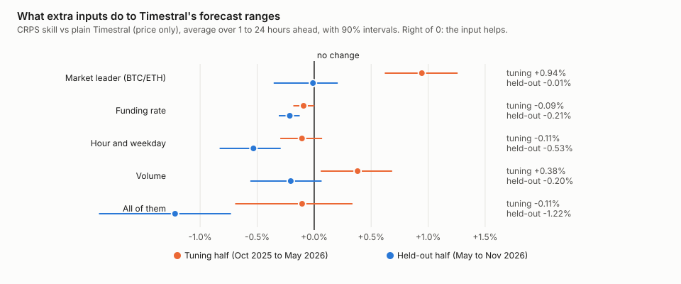
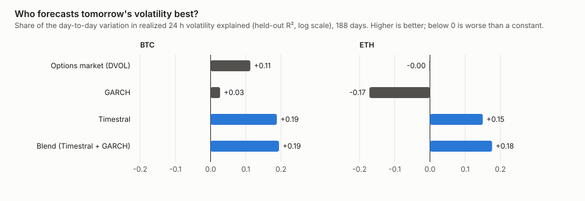

# Part 3: Better inputs, and a match against the options market

coinband project · November 2026 · unofficial, not affiliated with Mistral AI, Binance or Deribit · not financial advice

> **The short version**
>
> - [Part 2](risk.md) showed that Timestral is a better risk model than the standard statistical ones. Here we
>   asked two follow-up questions: **can it get better with more information**, and **how does it compare with the
>   options market**, where professionals put real money on volatility?
> - **Extra inputs mostly did not help.** Funding rates and the time of day made forecasts slightly worse, and all
>   inputs together made them clearly worse. Trading volume helped only for the very next hour. Feeding it Bitcoin's moves (for the other coins) sharpened its
>   volatility forecast, but not its forecast ranges overall.
> - **Against the options market, Timestral held its own.** For Bitcoin and Ether, it predicted the next day's
>   volatility better than the options market's own volatility index, and it carried information the options
>   market had not priced in.
> - **It also flagged when options were expensive**, better than GARCH did. A simplified option-selling test that
>   used it for timing did well, but GARCH did as well or better under a slightly different rule, so the trading edge
>   is not proven.

## Part A: can better inputs help?

Timestral can take extra information alongside the price: other time series it sees up to "now" (past
covariates), and things known in advance, such as the calendar (known covariates). We tried the most popular
candidates in crypto trading, one at a time and then all together:

- **Market leader**: Bitcoin's hourly moves when forecasting the other coins (and Ether's for Bitcoin). Most coins
  follow Bitcoin.
- **Funding rate**: the fee that long and short traders of perpetual futures pay each other every eight hours. It
  shows how crowded one side of the market is.
- **Hour and weekday**: crypto trades around the clock, but activity follows the working hours of the big markets.
- **Volume**: how much is being traded, with the size of the last hourly move.



The result is mostly a no:

- **Funding rate and the calendar made things slightly worse**, clearly so in the held-out half (−0.2% and −0.5%).
- **Volume helped the next hour** in both halves (as in part 1), but hurt a day ahead, and overall the gain did not
  hold up in the held-out half.
- **The market leader** improved the forecast ranges a lot in the tuning half (+0.9%) but not at all in the held-out
  half. What it did improve in both halves is the **volatility** forecast: with Bitcoin's moves as input, Timestral's
  24-hour volatility forecast beat GARCH's in the held-out half, which the plain model did not.
- **All of them together**: clearly **worse** than the plain model in the held-out half (−1.22%, interval −1.89 to −0.73), and even worse than GARCH. More inputs gave the model more noise to latch onto, not more signal.

Why so little? The price itself already carries most of what these inputs say. Funding rates move with price
trends, volume rises when prices jump, and Bitcoin's moves are largely already in each coin's own price.

<details>
<summary>For experts: inputs tables</summary>

Same eight pairs and halves as part 2; origins every 12 hours (about 375 per pair and half); Timestral-209M,
4096-hour context; covariates as extra rows (`market`: leader log return and absolute return; `funding`: rate in
basis points, forward-filled to the hour it is known; `calendar`: sine and cosine of hour of day and day of week,
as known covariates over the horizon; `volume`: log volume and absolute return; `all`: everything). CRPS skill is
pooled over pairs, averaged over 1 to 24 hours ahead, with 90% block-bootstrap intervals (blocks of 48 hours).
QLIKE: 24-hour volatility, lower is better.

| Inputs | Half | vs plain h=1 | vs plain h=24 | vs plain avg (90% CI) | vs GARCH avg (90% CI) | QLIKE inputs / plain / GARCH | VaR 1% hits |
|---|---|---|---|---|---|---|---|
| Market leader | tuning | +0.56 | +0.85 | +0.94 (+0.62, +1.26) | +1.15 (+0.68, +1.59) | 0.288 / 0.325 / 0.457 | 0.50% |
| Market leader | held-out | −0.22 | −0.33 | −0.01 (−0.36, +0.21) | +0.50 (+0.07, +0.87) | 0.390 / 0.455 / 0.405 | 0.83% |
| Funding rate | tuning | +0.02 | −0.14 | −0.09 (−0.18, +0.00) | +0.11 (−0.20, +0.41) | 0.318 / 0.325 / 0.457 | 0.37% |
| Funding rate | held-out | +0.02 | −0.29 | −0.21 (−0.31, −0.13) | +0.30 (+0.02, +0.64) | 0.444 / 0.455 / 0.405 | 0.80% |
| Hour and weekday | tuning | −0.26 | −0.29 | −0.11 (−0.30, +0.07) | +0.10 (−0.24, +0.44) | 0.322 / 0.325 / 0.457 | 0.40% |
| Hour and weekday | held-out | −0.08 | −0.78 | −0.53 (−0.83, −0.29) | −0.02 (−0.42, +0.38) | 0.444 / 0.455 / 0.405 | 0.99% |
| Volume | tuning | +1.15 | −0.02 | +0.38 (+0.06, +0.68) | +0.58 (+0.15, +0.99) | 0.300 / 0.325 / 0.457 | 0.66% |
| Volume | held-out | +0.22 | −0.61 | −0.20 (−0.56, +0.07) | +0.31 (−0.15, +0.73) | 0.423 / 0.455 / 0.405 | 0.90% |
| All of them | tuning | +1.06 | −0.96 | −0.11 (−0.69, +0.34) | +0.10 (−0.50, +0.62) | 0.305 / 0.325 / 0.457 | 0.53% |
| All of them | held-out | −0.77 | −1.99 | −1.22 (−1.89, −0.73) | −0.70 (−1.34, −0.12) | 0.437 / 0.455 / 0.405 | 0.86% |

Plain Timestral vs GARCH at these origins: +0.20% (tuning), +0.51% (held-out).

</details>

## Part B: Timestral against the options market

Options are insurance against big price moves, and their prices reveal how much movement the market expects.
Deribit, the largest crypto options exchange, publishes this expectation as an index called **DVOL** (like the VIX for
stocks): the volatility that option prices imply over the next 30 days.

That makes DVOL the toughest yardstick yet. It is set by professional traders with real money at stake, and it can
react to news that no price chart shows. We compared it with Timestral, GARCH and the blend from part 2 at one
task: **forecasting how much Bitcoin and Ether will move over the next 24 hours**, every day for six months that
none of the tuned models had seen.

### Who forecasts volatility best?



The bars show how much of the day-to-day variation in actual volatility each forecast explains. **Timestral explained
more than the options market**: 0.19 against 0.11 for Bitcoin, and 0.15 against 0.00 for Ether. GARCH did worst.
The blend of Timestral and GARCH was best for both coins.

This is less surprising than it sounds. DVOL looks 30 days ahead and includes a premium that option buyers pay for
protection, so it is not built to forecast tomorrow. But it is the number traders watch, and Timestral reads the
next day better.

### Does Timestral know something the options market does not?

When we put DVOL and Timestral in the same model, **both mattered**. Timestral's contribution stayed clearly
positive next to DVOL for both coins. In other words, Timestral's forecast carries information about the next day
that option prices had not priced in.

### Can it tell when options are expensive?

Option sellers earn the gap between the volatility they sell (implied) and the volatility that actually happens. On
average that gap was large: implied daily volatility was about 1.3 times the volatility that followed. But it changes
from day to day. A forecaster that knows when options are especially overpriced is valuable.

The gap between DVOL and Timestral's own forecast lined up with the premium sellers actually earned the next day: a
correlation of about **+0.3** for both coins. GARCH's version of the same signal managed +0.18 for Bitcoin and
nothing for Ether.

We then tried a simplified trade: each day, "sell" one day of volatility at the options market's price and pay out
whatever volatility actually happens (the logic of a variance swap), either every day or only on days when DVOL is
far above a model's forecast.

- Selling every day made money on average but with large swings (risk-adjusted return, or Sharpe ratio, 0.7 for
  Bitcoin and 1.6 for Ether).
- Selling only when DVOL was far above Timestral's forecast raised the risk-adjusted return **two to six times**
  (Sharpe 3.9 for Bitcoin, 3.3 for Ether).
- **But GARCH can do this too.** With a rule that compares each day's gap with its own recent average, GARCH timing
  did even better for Bitcoin (6.4) and much worse for Ether (0.2). Timestral was steadier across the two coins, but
  with six months of data the difference is not reliable.

So timing option sales with a volatility model works in this test. Timestral is the better forecaster, but this
trade does not yet show it pays off more than GARCH would.

<details>
<summary>For experts: options tables</summary>

Daily, non-overlapping origins (one per day at the same hour), BTC and ETH, tuning half for fits and thresholds,
held-out half (188 days) for scores. Target: realized variance of the next 24 hours (sum of squared hourly log
returns). DVOL converted to a daily variance as (DVOL/100)²/365, assuming a flat term structure. Model variances from
the 24-hour P15 to P85 spread.

| BTC, held-out | QLIKE raw | QLIKE recalibrated | R² (log RV) | Mincer-Zarnowitz slope |
|---|---|---|---|---|
| DVOL | 0.448 | 0.459 | 0.113 | 1.84 |
| GARCH | 0.511 | 0.474 | 0.027 | 1.07 |
| Timestral | 0.473 | 0.427 | 0.188 | 1.04 |
| Blend | 0.465 | **0.406** | **0.194** | 1.26 |

| ETH, held-out | QLIKE raw | QLIKE recalibrated | R² (log RV) | Mincer-Zarnowitz slope |
|---|---|---|---|---|
| DVOL | 0.461 | 0.536 | −0.002 | 1.83 |
| GARCH | 0.465 | 0.578 | −0.172 | 1.58 |
| Timestral | 0.610 | 0.538 | 0.150 | 0.97 |
| Blend | **0.459** | **0.471** | **0.176** | 1.59 |

Recalibration: log RV = a + b·log forecast, fitted on the tuning half (removes the premium and horizon mismatch).

Encompassing (held-out OLS of log RV on log DVOL and log Timestral variance, 90% block-bootstrap intervals over weeks):
BTC b_DVOL = +1.55 (+0.82, +2.49), b_Timestral = +0.55 (+0.26, +0.80); ETH b_DVOL = +1.66 (+0.93, +2.97),
b_Timestral = +0.48 (+0.10, +0.74).

Volatility risk premium (log implied minus log realized variance, next 24 h) against the signal log DVOL − log model
forecast, held-out correlation: BTC GARCH +0.18 (+0.05, +0.26), Timestral +0.31 (+0.17, +0.43), blend +0.30 (+0.18,
+0.41); ETH GARCH −0.09 (−0.26, +0.02), Timestral +0.28 (+0.13, +0.42), blend +0.26 (+0.12, +0.36).

Variance-selling proxy: daily P&L = DVOL²/365 − realized variance, in annualized variance points; the "≫ model" rule
sells when the gap is at or above its tuning-half median; the trailing rule sells when the gap exceeds its own
trailing 90-day median. Sharpe annualized from daily P&L, 90% block-bootstrap intervals.

| Held-out | BTC days sold | BTC Sharpe (90% CI) | ETH days sold | ETH Sharpe (90% CI) |
|---|---|---|---|---|
| Always sell | 188 | 0.66 (−1.96, 5.09) | 188 | 1.60 (−0.97, 7.01) |
| DVOL ≫ GARCH | 8 | −0.10 | 1 | n/a |
| DVOL ≫ Timestral | 115 | **3.87 (1.97, 8.15)** | 121 | **3.28 (0.75, 10.27)** |
| DVOL ≫ blend | 76 | 4.14 (1.64, 8.40) | 21 | 0.04 (−1.41, 6.19) |
| Trailing rule, GARCH | 73 | 6.43 (4.35, 9.38) | 54 | 0.23 (−1.80, 3.20) |
| Trailing rule, Timestral | 119 | 3.27 (−0.01, 8.30) | 108 | 2.33 (−0.36, 8.65) |
| Trailing rule, blend | 94 | 4.70 (2.12, 8.70) | 90 | 1.97 (−0.31, 7.54) |

The GARCH "≫" rule barely traded because GARCH's gap shifted level between the halves. Worst single days: −10,827
(BTC, always sell) and −26,345 (ETH) variance points: short volatility has fat left tails, and 188 days do not
sample them well.

</details>

## What this means

- **Keep the inputs simple.** Price alone is nearly as good as anything we added; Bitcoin's moves help only the
  volatility forecast, and volume only the next hour.
- **Timestral is a serious volatility forecaster**, good enough to beat the options market's index at forecasting the
  next day, and to carry information that index does not.
- **The most promising use is pricing risk**: comparing its forecast with what options charge. It spots expensive
  options better than GARCH. Whether that makes more money than a GARCH-based rule needs a longer test with real
  option prices.

## Limitations

- **Six months of held-out days, two coins** for the options tests, with fat-tailed results. The intervals are rough.
- **DVOL is not a 24-hour forecast.** It is a 30-day, risk-neutral number. The recalibrated scores correct for that
  on average, but not day by day.
- **The trade is a proxy.** There is no one-day variance swap on Deribit. Real option selling involves choosing strikes
  and expiries, spreads, hedging costs and margin, none of which is modelled here.
- **The inputs test used a forecast every 12 hours**, fewer than part 2's hourly forecasts, to keep the extra inputs
  affordable.
- **Timestral's settings were partly chosen on months that fall in the held-out half** (see part 2).

## Check it yourself

```bash
uv sync
uv run python experiments/phase1/collect.py --device mps          # hourly forecasts, needed by both parts
uv run python experiments/phase2/inputs.py collect --device mps   # ~1.5 h on an Apple-silicon GPU
uv run python experiments/phase2/inputs.py evaluate
uv run python experiments/phase3/options.py                       # fetches DVOL history from Deribit
uv run python experiments/phase3/figures.py
```

## Words used here

- **Covariate**: an extra time series given to the model alongside the price.
- **Funding rate**: the periodic payment between long and short holders of perpetual futures.
- **Implied volatility**: the volatility that option prices imply; **DVOL** is Deribit's 30-day index of it.
- **Volatility risk premium**: how much implied volatility exceeds the volatility that actually happens.
- **Variance swap**: a contract that pays the difference between an agreed volatility level and the realized one.
- **R²**: the share of the variation in an outcome that a forecast explains; 0 means no better than a constant.
