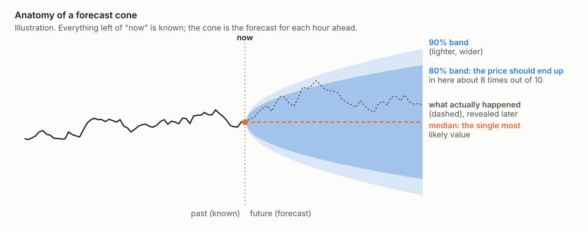
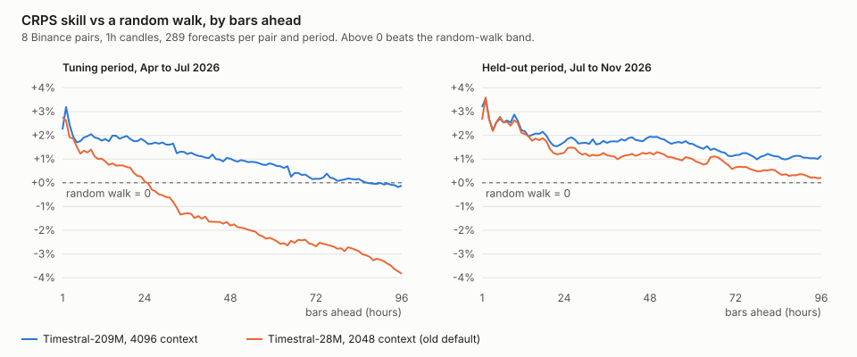

# Can an AI forecaster read the crypto market? We tested Mistral's Timestral on eight coins

coinband project · November 2026 · unofficial, not affiliated with Mistral AI or Binance · not financial advice

> **The short version**
>
> - Timestral, Mistral's open time-series model, gives **honest ranges**: when it says "80% chance the price
>   lands in this band", the price lands there about 80% of the time.
> - Those ranges are **a little better than a simple statistical guess**, about 2% better, on every one of the
>   eight coins we tried, including on months the model was never tuned on.
> - It **cannot tell you the direction**. Its "most likely" price is no better than "the price stays where it is",
>   and it gets up or down right about half the time, like a coin flip.
> - It is **best for the next few hours** and fades after a day or two.
> - Adding the recent trend made forecasts **much worse**. A bigger model with more history made them a bit better.

You can replay every forecast in the [interactive demo](demo/) and rerun everything on your own machine
([how](#check-it-yourself)).

## What we did, in plain words

Think of a weather forecast. A good one does not say "it will be 21°C". It says "between 18 and 24°C, most
likely 21". Timestral forecasts prices the same way: for every hour ahead it gives a **range** (a band) and a
**most likely value** (the median). Drawn over time, the bands widen into a cone, because the further ahead you
look, the less sure anyone can be.



To find out whether those cones are any good, we did what is called a **walk-forward backtest**:

1. Go back in time to some moment, and show the model only the prices up to that moment.
2. Ask it for a cone covering the next 96 hours.
3. Step forward 8 hours and repeat, a few hundred times per coin.
4. Then compare each cone with what the price actually did.

The model never sees the future it is asked about, so this is a fair test. We did it on hourly prices of
**BTC, ETH, SOL, BNB, XRP, DOGE, ADA and LINK** from Binance.

To avoid fooling ourselves, we split time in two:

- a **tuning period** (April to July 2026), used to pick the best settings, and
- a **held-out period** (July to November 2026), used once at the end to check that the chosen settings still
  work on months we never looked at while choosing.

<details>
<summary>For experts: protocol</summary>

- Data: hourly closed candles from Binance's public market-data API, 13,152 hours per pair (May 2025 to
  November 2026), frozen in a local cache so every run sees the same data.
- At each forecast origin the model sees at most `context` hours before it (NaN-padded when shorter) and
  returns 21 quantiles (P01 to P99) for each of the next 96 hours.
- Origins are 8 hours apart; 300 per pair and period, of which the 289 whose 96 hours have fully played out
  are scored.
- Tuning origins run from 2026-04-20 to 2026-07-29, held-out origins from 2026-07-29 to 2026-11-06.
- Screening: 35 configurations on the tuning period and four pairs (BTC, ETH, SOL, BNB). Confirmation: eight
  configurations on all eight pairs in both periods. The default was chosen on the tuning period; held-out
  numbers were computed once, after that choice.
- Models: Timestral-5M, 28M, 123M and 209M from the upstream release, unmodified, with the library's default
  test-time augmentation (symmetric averaging and non-negative clipping).

</details>

## How we score a cone

We look at three things.

**1. Are the ranges honest?** If the model's 80% band is right, the price should land inside it about 80% of
the time. Much less means the model is overconfident, much more means it is vague. We call this **coverage**.

**2. Is the whole cone better than a simple guess?** For this we need a yardstick. Ours is the
**random walk**: a cone built only from how much the price has been jumping around lately, centered on the
current price. It is the standard "know-nothing" forecast in finance, and it is surprisingly hard to beat.

We score both cones with the same rule, called **CRPS**. It rewards a cone that is both **close to what
happened** and **as narrow as it can honestly be**. A wide cone that always contains the price loses points for
being vague; a narrow cone that misses loses points for being wrong.

The headline number, **CRPS skill**, says how much smaller Timestral's error is than the random walk's:

- **+2%** means Timestral's cones are 2% better than the simple guess.
- **0%** means no better.
- **Below 0** means the simple guess was better.

**3. Does it know the direction?** We check whether the most likely value went the right way (up or down)
24 hours ahead, and whether it is closer to the real price than just assuming the price stays flat.

<details>
<summary>For experts: scoring details</summary>

- All errors are divided by the last known price, so pairs with very different prices pool fairly.
- CRPS is approximated as twice the mean pinball loss over the model's 21 quantile levels, applied the same way
  to the forecast and the baseline.
- Random-walk baseline: last price × exp(σ·√k·z_q) for quantile level q at step k, with σ the standard
  deviation of the previous 500 one-hour log returns.
- CRPS skill = 1 − ΣCRPS(forecast) / ΣCRPS(random walk), pooled over pairs and origins, over steps 1 to h.
- MAE skill: the median against "price stays flat".
- Calibration error: mean absolute gap between each quantile level and how often the price came in at or below
  that quantile.
- Direction hit: whether the median got the sign of the move h hours ahead right; a flat call counts as a miss.
- Confidence intervals: 90% moving-block bootstrap over origins, blocks of 12 origins (96 hours) so overlapping
  forecasts stay together, 1000 resamples, the same resamples for every configuration so differences are paired.

</details>

## What we found

### 1. The ranges are honest, and a little better than the simple guess

With the settings we ended up choosing (the largest model, Timestral-209M, looking at the last 4096 hours,
about 170 days), the 80% band held the real price **82% of the time** in the tuning period and **79%** in the
held-out period. That is close to the promised 80%.

Its cones scored about **2% better than the random walk** 24 hours ahead: +1.9% in the tuning period and
+2.1% in the held-out one. That is a small edge, but it showed up **on every coin, in both periods**:

| CRPS skill, 24 h ahead | ADA | BNB | BTC | DOGE | ETH | LINK | SOL | XRP |
|---|---|---|---|---|---|---|---|---|
| Tuning period | +2.13 | +2.34 | +1.87 | +1.53 | +1.64 | +1.93 | +2.07 | +1.71 |
| Held-out period | +1.90 | +0.82 | +2.39 | +2.96 | +2.81 | +0.60 | +1.17 | +4.19 |

### 2. It knows how much the price may move, not which way

This is the most important result for anyone hoping to trade on it. The model's "most likely" price was
**no better than assuming the price stays flat** (0.07% worse on average), and it called the direction
24 hours ahead right **51 to 52% of the time**, which is no better than a coin flip.

So the 2% edge comes entirely from the **shape and width of the cone**: Timestral is better at judging how
nervous the market is than a fixed formula is. That is useful for sizing risk ("how far could this go by
tomorrow?"), not for predicting profit.

### 3. It is most useful for the next few hours

The edge is largest one to six hours ahead (+2 to +3%) and shrinks the further out you look:



The orange line is where we started (a smaller model with less history). In the tuning period it fell below
the random walk after about a day. The blue line, our final choice, held its edge for almost four days.

### 4. What helped: a bigger model and more history, up to a point

| Change | Effect, 24 h ahead |
|---|---|
| Smaller model with 2048 h of history → 209M with 4096 h | **+1.0** points (tuning), +0.2 (held-out) |
| 2048 → 4096 hours of history (209M) | about +0.1, more at long horizons |
| 4096 → 8192 hours of history (209M) | **worse**, especially for the next hour |
| Bigger model (28M → 123M → 209M) | small gains, mostly far ahead |

More history helps the model judge the market's mood, but beyond about half a year it starts to blur the
recent picture: with 8192 hours the very next hour got clearly worse.

### 5. What made it worse

- **Adding the recent trend.** We tried tilting every cone in the direction the price had been moving. It made
  forecasts **much worse**: up to 13 points below the plain model. Short-term crypto momentum simply did not
  continue often enough over this period.
- **Trading volume as an extra input.** It sharpened the very next hour a bit, but hurt or did nothing for a day
  ahead and beyond, and it makes the model six times slower. We left it off.
- **Feeding log prices instead of prices** was slightly worse; the model already rescales its input.

<details>
<summary>For experts: the full tables with confidence intervals</summary>

**The shortlist, eight pairs.** CRPS skill vs the random walk, % (steps 1 to h):

| Configuration | Tuning h=1 | h=6 | h=24 | h=96 | Held-out h=1 | h=6 | h=24 | h=96 |
|---|---|---|---|---|---|---|---|---|
| **209M, ctx 4096 (default)** | +2.24 | +2.12 | **+1.90** | +0.73 | +3.19 | +2.72 | **+2.13** | +1.51 |
| 209M, ctx 2048 | +3.41 | +2.38 | +1.83 | +0.24 | +3.20 | +2.67 | +2.00 | +1.02 |
| 123M, ctx 4096 | +2.18 | +2.06 | +1.76 | +0.52 | +3.04 | +2.69 | +2.02 | +1.42 |
| 209M, ctx 8192 | −0.42 | +1.37 | +1.65 | +0.38 | +1.26 | +2.18 | +1.93 | +1.07 |
| 28M, ctx 4096 | +2.53 | +1.99 | +1.51 | −0.00 | +2.96 | +2.77 | +2.04 | +1.23 |
| 209M, ctx 4096, volume | +2.98 | +2.55 | +1.25 | −1.01 | +3.85 | +3.42 | +2.20 | +1.57 |
| 28M, ctx 4096, volume | +2.60 | +1.96 | +0.97 | −1.16 | +2.98 | +2.98 | +2.10 | +1.50 |
| 28M, ctx 2048 (old default) | +2.77 | +1.84 | +0.88 | −1.94 | +2.66 | +2.69 | +1.93 | +0.94 |

For the default, 24 hours ahead: MAE skill −0.07% in both periods, 80% coverage 82.0% and 79.3%, calibration
error 0.88 and 0.80 points, direction hit 50.9% and 51.8%.

**One change at a time.** Change in CRPS skill, percentage points, with 90% paired bootstrap intervals; bold
when the interval excludes zero:

| Change | Tuning h=1 | h=24 | h=96 | Held-out h=1 | h=24 | h=96 |
|---|---|---|---|---|---|---|
| Old default to 209M, ctx 4096 | −0.52 (−1.05, +0.09) | **+1.02 (+0.34, +1.78)** | **+2.66 (+0.78, +4.62)** | **+0.53 (+0.11, +0.94)** | +0.20 (−0.07, +0.36) | **+0.57 (+0.14, +0.96)** |
| Context 2048 to 4096, 209M | **−1.16 (−1.50, −0.81)** | +0.07 (−0.19, +0.38) | +0.48 (−0.10, +1.11) | −0.01 (−0.20, +0.17) | +0.13 (−0.01, +0.24) | **+0.49 (+0.11, +0.86)** |
| Context 4096 to 8192, 209M | **−2.66 (−3.35, −2.00)** | **−0.25 (−0.45, −0.08)** | **−0.35 (−0.62, −0.11)** | **−1.93 (−2.50, −1.32)** | −0.20 (−0.40, +0.02) | **−0.43 (−0.76, −0.12)** |
| 28M to 123M, ctx 4096 | −0.35 (−0.82, +0.52) | +0.25 (−0.02, +0.64) | **+0.52 (+0.02, +1.15)** | +0.08 (−0.50, +0.61) | −0.01 (−0.28, +0.26) | +0.18 (−0.49, +0.88) |
| 123M to 209M, ctx 4096 | +0.06 (−0.49, +0.36) | +0.14 (−0.06, +0.32) | +0.21 (−0.15, +0.63) | +0.15 (−0.21, +0.59) | +0.11 (−0.05, +0.26) | +0.09 (−0.12, +0.32) |
| Volume, 209M ctx 4096 | **+0.73 (+0.20, +1.14)** | **−0.65 (−1.36, −0.17)** | **−1.73 (−2.87, −0.97)** | **+0.66 (+0.28, +1.11)** | +0.06 (−0.35, +0.45) | +0.07 (−0.56, +0.65) |

**Trend drift** (screen: four pairs, tuning period, 28M with a 4096-hour context and volume): tilting each
forecast by the least-squares slope of log price over the last N hours moved CRPS skill 24 hours ahead from
+0.95% without trend by −13.3 points (N = 48), −4.6 (N = 168) and −1.1 (N = 720), and was worse at every
horizon tested.

**Log prices** (an earlier, smaller test with one forecast per hour on the most recent months): lowered CRPS
skill by about 0.1 points for both 28M and 209M.

</details>

## Is this useful?

**For trading direction: no.** Nothing here suggests the model can tell whether a coin will go up or down.

**For understanding risk: a little.** The cones are honest about uncertainty and slightly sharper than a
textbook volatility estimate, and they adapt as markets calm down or heat up. That makes them a reasonable,
transparent way to answer "what range is plausible for the next few hours?"

**For the model itself: a solid result.** We used Timestral as released, without fine-tuning it on these coins.
The random walk is a hard yardstick in finance, and beating it consistently, out of the box, on every coin and in
both periods is a meaningful result for a general-purpose model.

## Limitations

- **About 200 days, one market.** Two periods of about 100 days each, on eight coins that tend to move together.
  Calmer or wilder years could look different, and the ranking of close configurations already shifted between
  our two periods.
- **Hourly crypto only.** Daily data, stocks and indices are not covered here (the app can run them; that study
  is next).
- **The yardstick matters.** A stronger baseline (for example GARCH, or the spread of past returns) would shrink
  the skill numbers.
- **Forecast quality is not trading performance.** There are no fees, no positions and no strategy here.

<details>
<summary>For experts: statistical caveats</summary>

- The bootstrap resamples each pair separately and so ignores the correlation between pairs; the intervals are
  likely too narrow.
- Screening and the choice of default used the tuning period only, but the shortlist was informed by a few
  earlier exploratory runs on the most recent months (now the held-out period). The held-out numbers are
  therefore slightly optimistic.
- CRPS is approximated from 21 unevenly spaced quantiles.

</details>

## Check it yourself

**In your browser:** the [interactive demo](demo/) replays the last month of hourly forecasts for all eight
coins with Timestral-209M. Scrub through time, watch the cone move, and see every score update live.

**On your machine:** the app runs any Binance coin, and stocks, indices and currencies through Yahoo Finance,
with live forecasts that refresh every minute.

```bash
git clone https://github.com/darkbringer1/coinband && cd coinband
uv sync
uv run coinband            # then open http://127.0.0.1:8000
```

**Reproduce this study** (about half an hour on an Apple-silicon GPU, several hours on CPU):

```bash
uv run python experiments/sweep.py --stage screen --device mps
uv run python experiments/sweep.py --stage confirm --configs experiments/confirm.json --device mps
uv run python experiments/analyze.py --stage confirm --period test --ref test-1h-28M-ctx2048-cov0-trend0-h96
uv run python experiments/effects.py && uv run python experiments/figures.py
```

Prices are fetched once into a local cache. Your numbers will differ slightly if you run it on another day,
since the periods end at the latest closed candle.

## Next

[Part 2: Is an AI forecaster a better risk model than GARCH?](risk.md) puts these honest ranges to work as a risk
model, against the standard statistical tools.

## Words used here

- **Band / cone**: the range the model expects the price to stay in, drawn for each hour ahead.
- **80% band**: the range that should contain the price 80% of the time (from the 10th to the 90th percentile).
- **Median**: the model's single most likely value.
- **Random walk**: a simple forecast that assumes no direction and uses only recent volatility.
- **CRPS skill**: how much better a forecast's whole cone is than the random walk's; above 0 is better.
- **Context**: how many past hours the model looks at.
- **Backtest**: replaying the past and forecasting it as if it were the present, without peeking.
