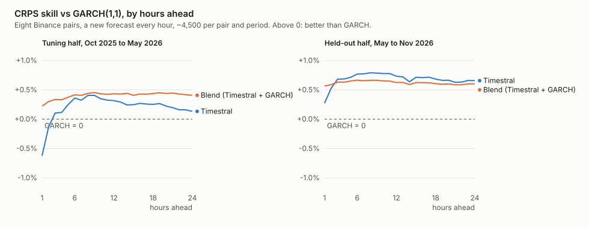
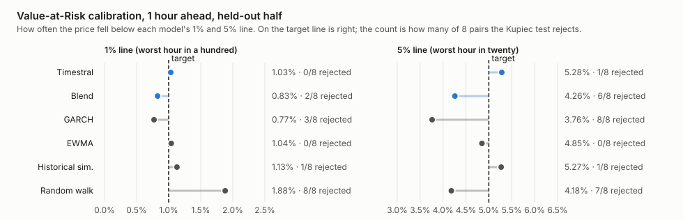
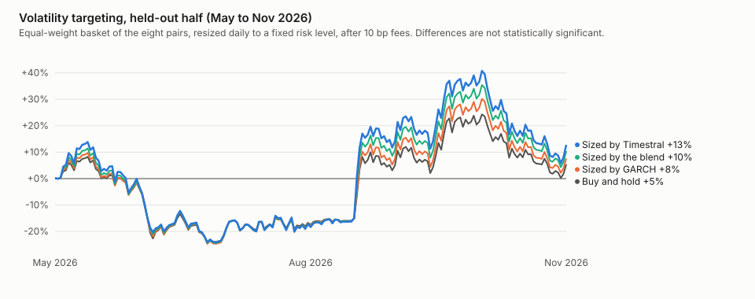

# Part 2: Is an AI forecaster a better risk model than GARCH?

coinband project · November 2026 · unofficial, not affiliated with Mistral AI or Binance · not financial advice

> **The short version**
>
> - [Part 1](paper.md) found that Timestral cannot call the direction of crypto prices, but its ranges are honest. So we
>   asked the question that matters for risk: **are its ranges better than the models professionals already use?**
> - We pitted it against four standard methods, including **GARCH**, the workhorse volatility model in finance,
>   on eight coins, with a new forecast every hour for a year.
> - **Its forecast ranges beat all four**, including GARCH, by a small margin that holds up statistically on
>   months the baselines were not tuned on. **Averaging Timestral with GARCH** is better than GARCH in both
>   halves of the year, and gives the best volatility forecast on the held-out half.
> - As a **"worst likely loss" (Value-at-Risk) model**, Timestral's 1-in-100 and 1-in-20 hour lines were hit about
>   as often as promised, and on the held-out half its 1-in-100 line had the smallest misses of any model. GARCH
>   was too cautious at the 1-in-20 level.
> - **No hidden sense of direction**: not in the band's shape, not in ranking coins against each other, once
>   trading costs are counted.
> - **Turning this into better trading results is not proven yet.** Sizing positions with Timestral did a little
>   better than sizing with GARCH, but six months is too short to tell that apart from luck.

## Why this question

In [part 1](paper.md) we learned two things about Timestral, Mistral's open forecasting model. It has no sense of
direction: its "most likely" price is no better than "the price stays put". But it is good at judging **how
much** the price might move.

That second skill is exactly what risk managers, traders and exchanges pay for. They do not need to know where
the price goes; they need a trustworthy answer to "how bad could the next hour or day get?" They already have
tools for that, and the question is whether Timestral beats them.

## The competition

We compared Timestral with four standard methods, from simplest to strongest:

- **Random walk**: assume the price wanders with the same jumpiness as over the last three weeks.
- **Historical simulation**: assume the next day looks like one of the last ~80 days, picked at random.
- **EWMA**: like the random walk, but recent hours count more, so it adapts when markets heat up or calm down
  (the method behind J.P. Morgan's RiskMetrics).
- **GARCH(1,1)**: the textbook volatility model. It knows that calm and stormy periods cluster and that storms
  fade back to normal over time.

All four were tuned on the **first half** of the year (October 2025 to May 2026) and judged on the **second half**
(May to November 2026). Timestral was used as released, with no tuning on this data.

We also tried a fifth contender: a **blend** that simply averages Timestral's and GARCH's ranges. Combining two
different forecasts often beats both.

<details>
<summary>For experts: setup</summary>

- Data: hourly closed candles from Binance's public API for BTC, ETH, SOL, BNB, XRP, DOGE, ADA and LINK, 13,152
  hours per pair, frozen in a local cache.
- Every hour from the first one with a full 4096-hour context, each model forecasts the next 24 hourly log
  returns (cumulative, 1 to 24 hours ahead) as 21 quantiles (P01 to P99). About 4,500 origins per pair in each
  half. Tuning half: origins 2025-10-25 to 2026-05-01. Held-out half: 2026-05-01 to 2026-11-05.
- Timestral-209M, 4096-hour context, price only (the defaults chosen in part 1).
- Random walk: normal, σ from the last 500 hourly returns, √k scaling.
- Historical simulation: empirical quantiles of the last 2000 overlapping k-hour returns.
- EWMA: λ fitted by QLIKE on the tuning half (0.98 for BTC); quantiles by filtered historical simulation (empirical
  quantiles of the tuning half's standardized residuals, scaled by √(kσ²)).
- GARCH(1,1): variance targeting, α and β fitted by Gaussian likelihood on the tuning half (α = 0.13, β = 0.81 for
  BTC); multi-step variance by the mean-reverting recursion; filtered historical simulation for the quantiles.
- Blend: the average of Timestral's and GARCH's quantiles at each level.

</details>

## Finding 1: Timestral's ranges beat every standard method

We score whole ranges with **CRPS** (see [part 1](paper.md#how-we-score-a-cone)): lower error is better, and
"skill" is how much lower than a competitor. Against GARCH, the strongest competitor:



On the held-out half, Timestral's ranges were **0.7% better than GARCH's** on average over the next 24 hours,
and better than every other method too:

| Timestral vs | Tuning half | Held-out half |
|---|---|---|
| Random walk | +1.3% | **+2.0%** |
| Historical simulation | +1.4% | **+1.6%** |
| EWMA | +0.3% | **+0.5%** |
| GARCH | +0.2% (not significant) | **+0.7%** |
| *Blend vs GARCH* | **+0.4%** | **+0.6%** |

Two things stand out. In the tuning half, GARCH was actually better than Timestral for the very next hour, and the
two were close overall. The **blend beat GARCH in both halves**, clearly, at every horizon. If you want one
dependable upgrade over GARCH, it is the blend.

For the volatility number alone (how big the next day's swings will be), the picture is similar: Timestral was
best in the tuning half, GARCH beat it in the held-out half, and the blend was close to the best in both.

<details>
<summary>For experts: forecast-quality tables</summary>

CRPS skill averaged over 1 to 24 hours ahead, pooled over pairs, with 90% moving-block bootstrap intervals
(blocks of 48 hours, paired across models), and at single horizons:

| Model vs baseline | Tuning h=1 | h=8 | h=24 | avg (90% CI) | Held-out h=1 | h=8 | h=24 | avg (90% CI) |
|---|---|---|---|---|---|---|---|---|
| Timestral vs RW | +2.58 | +1.67 | +0.72 | +1.32 (+0.91, +1.59) | +3.32 | +2.21 | +1.68 | +1.99 (+1.61, +2.43) |
| Timestral vs HS | +1.35 | +1.51 | +1.21 | +1.41 (+1.03, +1.78) | +1.93 | +1.46 | +2.05 | +1.63 (+1.27, +1.96) |
| Timestral vs EWMA | −0.34 | +0.30 | +0.38 | +0.33 (+0.13, +0.56) | +0.47 | +0.50 | +0.53 | +0.45 (+0.24, +0.67) |
| Timestral vs GARCH | −0.62 | +0.40 | +0.13 | +0.24 (−0.05, +0.50) | +0.27 | +0.79 | +0.66 | +0.69 (+0.40, +1.01) |
| Blend vs GARCH | +0.22 | +0.44 | +0.41 | +0.42 (+0.28, +0.58) | +0.56 | +0.66 | +0.60 | +0.62 (+0.48, +0.78) |

QLIKE of the 24-hour volatility (variance implied by the P15 to P85 spread, against the realized sum of squared
hourly returns; lower is better):

| | RW | HS | EWMA | GARCH | Timestral | Blend |
|---|---|---|---|---|---|---|
| Tuning | 0.347 | 0.450 | 0.554 | 0.446 | **0.319** | 0.333 |
| Held-out | 0.490 | 0.610 | 0.705 | 0.400 | 0.431 | **0.370** |

</details>

## Finding 2: a trustworthy "worst likely loss"

**Value-at-Risk** answers "how much could I lose in the next hour, in a bad case?" A "1% VaR" is a line the
price should fall below only once in a hundred hours. If it falls below more often, the model underestimates
risk (dangerous). If less often, it overestimates risk (you hold too little, or post too much collateral).



On the held-out half:

- **Timestral** was crossed 1.03% of the time at the 1% line and 5.28% at the 5% line, close to the targets.
  The standard test (Kupiec) rejected it on 0 of 8 coins at 1% and 1 of 8 at 5%. It also had the **smallest
  average miss** of all models at the 1% line.
- **EWMA** hit its targets just as well, with slightly larger misses.
- **GARCH** was too cautious at the 5% line (crossed only 3.76% of the time, rejected on all 8 coins), and the
  blend inherited part of that caution.
- The **random walk** badly underestimated risk at the 1% line (1.88%, rejected on all 8 coins).

In practice this makes Timestral a good engine for **stop-loss distances, risk limits and margin buffers**:
its lines are hit about as often as they promise, and it adapts to the market's mood hour by hour.

<details>
<summary>For experts: VaR tables</summary>

Left tail (long positions), pooled hit rates; Kupiec p-value median over pairs (rejections at 5%);
Christoffersen independence p-value median; quantile (pinball) loss ×10⁴; 24-hour VaR on non-overlapping days.

| Held-out | 1%@1h hits | Kupiec (rej.) | Chr. p | qloss | 5%@1h hits | Kupiec (rej.) | 1%@24h | 5%@24h |
|---|---|---|---|---|---|---|---|---|
| Timestral | 1.03% | 0.42 (0/8) | 0.37 | **2.212** | 5.28% | 0.34 (1/8) | 0.53% | 3.97% |
| Blend | 0.83% | 0.16 (2/8) | 0.45 | 2.224 | 4.26% | 0.02 (6/8) | 0.40% | 2.84% |
| GARCH | 0.77% | 0.12 (3/8) | 0.46 | 2.282 | 3.76% | 0.00 (8/8) | 0.33% | 2.65% |
| EWMA | 1.04% | 0.46 (0/8) | 0.31 | 2.316 | 4.85% | 0.66 (0/8) | 0.73% | 5.29% |
| HS | 1.13% | 0.44 (1/8) | 0.16 | 2.468 | 5.27% | 0.35 (1/8) | 1.92% | 5.95% |
| RW | 1.88% | 0.00 (8/8) | 0.04 | 2.536 | 4.18% | 0.01 (7/8) | 1.72% | 4.03% |

| Tuning | 1%@1h hits | Kupiec (rej.) | Chr. p | qloss | 5%@1h hits | Kupiec (rej.) |
|---|---|---|---|---|---|---|
| Timestral | 0.94% | 0.48 (0/8) | 0.03 | 2.682 | 4.94% | 0.26 (1/8) |
| Blend | 0.99% | 0.43 (0/8) | 0.06 | **2.665** | 4.80% | 0.22 (1/8) |
| GARCH | 1.13% | 0.57 (1/8) | 0.12 | 2.706 | 4.98% | 0.33 (1/8) |
| EWMA | 1.17% | 0.32 (0/8) | 0.00 | 2.804 | 4.99% | 0.84 (0/8) |
| HS | 0.93% | 0.33 (1/8) | 0.06 | 2.878 | 4.58% | 0.08 (3/8) |
| RW | 1.97% | 0.00 (8/8) | 0.00 | 3.021 | 4.19% | 0.02 (5/8) |

In the tuning half Timestral's 1% breaches were somewhat clustered (Christoffersen p = 0.03); the blend and GARCH
were not. At 24 hours Timestral's 1% line was conservative in the held-out half (0.53%).

</details>

## Finding 3: better sizing, but not proven

The classic way to cash in on a better volatility forecast is **volatility targeting**: hold more when the market
is calm, less when it is stormy, so that the risk you carry stays steady. We held an equal-weight basket of the
eight coins, resized each position once a day so its forecast 24-hour volatility matched a fixed target, and
charged 0.1% on every change.



Sizing with Timestral ended ahead of sizing with GARCH and of plain buy-and-hold in both halves, and it kept risk
steadier: the swings in realized volatility were a quarter to a half smaller than buy-and-hold's. **But the
differences are within the noise.** Over six months, the confidence interval for "Timestral sizing beats GARCH
sizing" runs from −0.27 to +0.61 in Sharpe ratio. Even the simple random walk sizing did well in the held-out
half. A real verdict needs years of data, or a setting where better risk numbers pay more directly.

<details>
<summary>For experts: strategy tables</summary>

Equal-weight basket of eight per-pair strategies; position w = min(2, target / forecast 24 h volatility), changed
once every 24 hours; target = median realized 24 h volatility over the tuning data; 10 bp per unit of position
change. Returns are annualized from about six months. Sharpe intervals: 90% block bootstrap over weeks.

| Held-out | Ann. return | Ann. vol | Sharpe (90% CI) | Max DD | Vol of vol | Turnover/pair |
|---|---|---|---|---|---|---|
| Buy and hold | +9.4% | 36.5% | 0.43 (−2.96, 3.49) | 32.6% | 10.2% | 1.0 |
| Timestral | +24.3% | 41.7% | 0.73 (−3.01, 3.91) | 35.8% | 7.4% | 25.4 |
| Blend | +19.5% | 39.7% | 0.65 (−3.01, 3.75) | 34.6% | 7.6% | 19.4 |
| GARCH | +13.7% | 38.7% | 0.53 (−2.99, 3.58) | 33.8% | 8.6% | 15.6 |
| EWMA | +3.6% | 47.6% | 0.31 (−3.37, 3.28) | 42.4% | 7.6% | 29.7 |
| HS | +16.3% | 44.7% | 0.56 (−2.90, 3.60) | 38.0% | 13.3% | 3.2 |
| RW | +33.5% | 37.8% | 0.95 (−3.06, 4.31) | 35.9% | 10.3% | 6.1 |

| Tuning | Ann. return | Sharpe | Max DD | Vol of vol |
|---|---|---|---|---|
| Buy and hold | −67.9% | −2.37 | 54.2% | 11.3% |
| Timestral | −62.9% | −2.28 | 50.7% | 5.5% |
| Blend | −66.7% | −2.41 | 53.0% | 6.5% |
| GARCH | −71.1% | −2.50 | 56.4% | 9.5% |
| EWMA | −68.5% | −2.10 | 56.9% | 5.7% |
| HS | −66.4% | −2.42 | 53.3% | 11.6% |
| RW | −60.8% | −2.34 | 47.4% | 7.7% |

Paired Sharpe differences: Timestral vs GARCH +0.22 (−0.39, +0.75) tuning, +0.20 (−0.27, +0.61) held-out; blend
vs GARCH +0.08 (−0.23, +0.36) and +0.12 (−0.13, +0.34); Timestral vs buy-and-hold +0.09 (−0.73, +0.81) and +0.30
(−0.32, +0.89).

</details>

## Finding 4: no hidden sense of direction either

Part 1 found that Timestral cannot call up or down for a single coin. Maybe the direction hides somewhere subtler:
in the **shape** of the band (more room up than down?), or in **comparing coins** (which of the eight will do
best?). We tested three Timestral signals (the median move, the band's lopsidedness, and the chance of going up)
against two simple rules any trader knows: **momentum** (what went up keeps going) and **reversal** (what went up
comes back).

- **For a single coin, nothing.** None of the Timestral signals predicted the next hour or day: their correlation with
  the actual move was about zero, and they got the direction right 48 to 52% of the time. The only consistent effect
  was plain short-term reversal, which Timestral does not capture.
- **Across coins, something, but not from Timestral.** Ranking the eight coins by Timestral's median did line up
  with which coins did better. But that ranking mostly mirrors volatility: Timestral expects calmer coins to hold up
  better, and calm coins did. The band's lopsidedness, once momentum and volatility are taken out, predicts close to
  nothing.
- **Nothing survives trading costs.** Every long-short version we tried, rebalanced daily with a 0.1% fee, lost
  money or was indistinguishable from zero in the held-out half. Trading eight coins against each other every day
  costs more than these faint signals can earn.

<details>
<summary>For experts: direction tables</summary>

Signals at each hourly origin: `median` (forecast median log return), `skew` ((P90 − P50) − (P50 − P10)) / (P90 −
P10)), `p_up` (P(return > 0) interpolated from the 21 quantiles); baselines `mom24` (last 24 h return), `rev1`
(minus last 1 h return), `rev24` (minus last 24 h return). Time-series IC: Spearman with the realized h-hour return
per pair, averaged over pairs; cross-sectional IC: Spearman across the eight pairs each hour, averaged; 90%
block-bootstrap intervals. Long-short: long the top two, short the bottom two, rebalanced every 24 h, 10 bp per
unit of position change.

| Time-series IC, h = 24 | Tuning | Held-out | Hit rate held-out |
|---|---|---|---|
| median | −0.072 (−0.134, −0.011) | −0.011 (−0.068, +0.041) | 51.5% |
| skew | −0.023 (−0.116, +0.044) | −0.033 (−0.120, +0.049) | 48.5% |
| p_up | −0.076 (−0.139, −0.016) | −0.014 (−0.064, +0.033) | 51.6% |
| rev1 (h = 1) | +0.030 (+0.011, +0.048) | +0.038 (+0.020, +0.057) | 50.9% |

| Cross-sectional, h = 24 | IC tuning | IC held-out | Long-short Sharpe held-out (90% CI) |
|---|---|---|---|
| median | +0.066 (+0.034, +0.105) | +0.109 (+0.069, +0.146) | −0.54 (−2.03, +0.78) |
| minus skew | +0.058 (+0.028, +0.091) | +0.075 (+0.043, +0.108) | +0.08 (−1.73, +1.68) |
| minus skew, residual after momentum and band width | +0.004 (−0.024, +0.031) | +0.039 (+0.016, +0.066) | −0.71 (−2.58, +0.81) |
| low volatility (minus band width) | +0.082 (+0.040, +0.123) | +0.065 (+0.024, +0.108) | +0.08 (−1.42, +1.49) |
| rev24 | +0.127 (+0.096, +0.159) | +0.057 (+0.020, +0.091) | −1.33 (−2.60, +0.07) |

The median's cross-sectional rank correlation with the band width is −0.33 (tuning) and −0.44 (held-out). Turnover
of the daily long-short is about 1.6 per day, so 10 bp fees cost roughly 0.16% a day, more than the gross edge of
any signal tested. Many signals and variants were tried; none is positive after costs in both halves.

</details>

## What this means

- **For risk numbers, Timestral is a real upgrade.** Its ranges beat GARCH, EWMA and historical simulation on
  months none of the tuned models had seen, and its Value-at-Risk lines are hit about as often as they promise.
- **The safest upgrade is the blend.** Averaging Timestral with GARCH beat GARCH clearly in both halves of the year,
  and costs nothing beyond running both.
- **It is not a money machine.** Better risk estimates did not produce a provably better strategy over six
  months, and there is no hidden directional signal that survives trading costs. Where they should pay off most directly is in pricing risk itself, such as options, which is what we
  test next.

## Limitations

- **One year, one market, eight coins that move together.** The confidence intervals resample each coin separately
  and ignore how coins move together, so they are likely too narrow.
- **Timestral's settings were chosen with some of this data.** The 209M model and the 4096-hour context were picked
  in part 1 using April to July 2026, which falls inside this held-out half. The baselines were tuned only on the
  first half. Timestral's held-out numbers are therefore slightly flattering.
- **Stronger baselines exist**, such as GARCH variants with asymmetry or Student-t errors, realized-volatility
  models, and implied volatility from options.
- **No real trading.** No slippage beyond a flat 0.1% fee, no funding costs, no execution.

## Check it yourself

```bash
uv sync
uv run python experiments/phase1/collect.py --device mps   # ~30 min on an Apple-silicon GPU
uv run python experiments/phase1/risk.py                   # baselines, scores, strategies (~1 min)
uv run python experiments/phase1/figures.py
uv run python experiments/phase1/direction.py           # direction signals (~3 min)
uv run python experiments/phase1/skew_check.py
```

The forecasts are cached in `experiments/results/phase1/`, the summary in `summary.md` and `summary.json` there.

## Next

[Part 3: Better inputs, and a match against the options market](options.md) tests whether extra data improves the
forecasts, and how Timestral compares with the volatility that option prices imply.

## Words used here

- **Volatility**: how big the price swings are, regardless of direction.
- **GARCH**: the standard statistical model of volatility; it captures that stormy and calm periods cluster.
- **EWMA**: a moving average of recent squared returns, weighted toward the latest hours.
- **Value-at-Risk (VaR)**: a loss level that should be exceeded only a given share of the time, such as 1 hour in 100.
- **Kupiec test**: checks whether a VaR line is crossed as often as it promises.
- **Volatility targeting**: resizing a position so the risk it carries stays roughly constant.
- **Sharpe ratio**: return per unit of risk; higher is better.
- **Blend**: the average of two models' forecast ranges.
